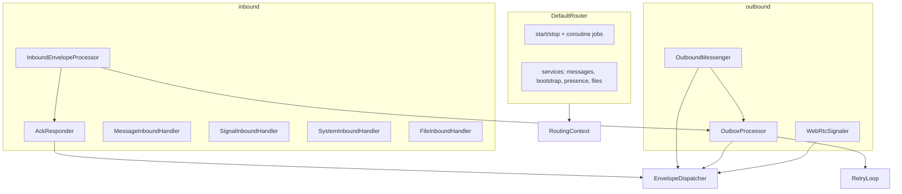

# Router decomposition guide

This document tracks the split of `DefaultRouter` into focused collaborators.

The public `Router` is a lifecycle (`start` / `stop` / `isRunning`) plus one service per concern, each a narrow
interface in `routing/router` (files: `routing/file/port`):

| Service            | Members                                                                                                                     |
|--------------------|-----------------------------------------------------------------------------------------------------------------------------|
| `MessageCarrier`   | `sendMessage`, `incomingMessages`, `deliveries`, `sendTypingIndicator`, `typingIndicators`, `frontiers`, `startSync`, `reopenSync` |
| `BootstrapCarrier` | `sendBootstrap`, `bootstrapPackets`, `deliveries`                                                                            |
| `Presence`         | `onlineAccounts`, `accountReach`, `localLinkStatus`, `localTorEndpoint`, `announceOnline`                                    |
| `FileCarrier`      | `pushFile`, `cancelFile`, `sendState`, `startFilePull`, `abortLargeFile`, `endIncoming`, `fileEvents`                     |

The message service owns both directions: push (send, typing, receipts) and pull (asking for and serving missing
history — the former separate sync service). Its cross-layer content ports live in `routing/message/port`.

Orchestrator components take only the services they use. The file machinery (seal registry, transfer
sessions, relay door and forwards, the large path, the pull loop, inbound face) is assembled in
`routing/file/FileService`, which *is* the `FileCarrier`. The router
builds it from its shared kernel and the orchestrator ports/stores wiring passes in; the router routes FILE
packets and outcomes to it. No other file assembly layer exists.

## Goal

`DefaultRouter` is now a thin orchestrator that composes single-responsibility classes, matching the existing
`routing/outbox` and `routing/policy` packages.

## Target package layout

```
routing/
  router/                 Router + one interface per service; DefaultRouter (composition +
                          lifecycle); RouterConfig, TransportLimits, FileLimits, RoutingTypes
                          (context + vocabulary), RouterLifecycle, OutcomeMailbox,
                          LocalLinkStatus
  inbound/                InboundEnvelopeHandler, InboundEnvelopeProcessor, and the two
                          kernel-owned family handlers: SystemInboundHandler, SignalInboundHandler
  outbound/               EnvelopeDispatcher, OutboxProcessor (incl. relay copies), RetryLoop,
                          SystemSender, WebRtcSignaler
  presence/               PresenceService, PingProvider, PeerAvailabilityRegistry
  link/                   PeerLinks (device-keyed links over every transport), TorPeerSessions
                          (Tor's endpoint-keyed sessions re-keyed by device id), LinkKeeper
  policy/                 outbound/relay/sync policies
  candidate/              shared candidate-asking loop: CandidateStrategy (what every loop
                          plugs in, including its CandidateLedger), OutboxAttemptStrategy (the packet half, carried by the
                          outbox executor), CandidateRequestCore (engine)
  store/                  routing-owned stores, OutboxTag (sealed, typed ids), PacketStoreMaintenance
  message/                MessageService (+ inbound face, pull processor, messenger, ports)
  bootstrap/              BootstrapService (+ sender, inbound handler)
  file/                   FileService (+ port/, seal/, transfer/, relay/, inbound/, large/)
```

## Architecture



## Completed steps

### Step 1: `RoutingContext` + `EnvelopeDispatcher`

**Files:** `routing/router/RoutingTypes.kt` (context), `routing/outbound/EnvelopeDispatcher.kt`

`RoutingContext` is the ambient routing world, built by the composition root (`NodeGraph`) and handed
to `DefaultRouter` as one constructor parameter: who we are (`localIdentity`, `localDeviceId`), the
device world (`devices`), how we reach peers (`torTransport`, `webRtcTransport`, `peerLinks`,
`transportLimits`), sealing (`envelopeProtections`), time and rules (`clock`, `routerConfig`).
It carries **no** stores, engines or policies: routing-owned state (`routes`, the packet
deduplicator, the outbox) and everything routing builds are explicit dependencies of their owners.

`EnvelopeDispatcher` is the single send path for Tor vs WebRTC:

- `dispatch(envelope, transport)` — used by outbound send, outbox retries, ACK/NACK, and WebRTC signaling
- resolves a peer's Tor endpoint through the `DeviceRouteStore` it is handed

### Step 2: `AckResponder`

**File:** `routing/inbound/AckResponder.kt`

Owns inbound reply envelopes:

- `sendAck(...)`
- `sendNack(...)`
- `sendDispositionForDuplicate(...)`

Uses `EnvelopeDispatcher` to send protected `SYSTEM` envelopes. `InboundEnvelopeProcessor` delegates ACK/NACK to
`AckResponder`.

### Step 3: Per-type inbound handlers

**Files:** `routing/inbound/handlers/*.kt`, `routing/inbound/InboundEnvelopeHandler.kt`

- `MessageInboundHandler` — decodes/opens messages, emits to `Router.incomingMessages`
- `SignalInboundHandler` — opens WebRTC bootstrap signals
- `SystemInboundHandler` — decodes/opens system payloads, returns `SystemInboundResult`
- `FileInboundHandler` — stub until Sprint 5

Inbound protection failure mapping lives in `routing/inbound/InboundEnvelopeHandler.kt`. System message outcomes use
`SystemInboundResult` in `RoutingTypes.kt`.

### Step 4: `InboundEnvelopeProcessor`

**File:** `routing/inbound/InboundEnvelopeProcessor.kt`

Owns the inbound pipeline and transport ingress wrappers:

- `handle(envelope, transport)` — dedup → expiry → target check → handler dispatch → ACK/NACK (or `SystemInboundResult`
  effects for SYSTEM)
- `handleTorInbound(...)` — Tor endpoint learning + processing
- `handleWebRtcInbound(...)` — WebRTC envelope processing

### Step 5: `OutboxProcessor`

**File:** `routing/outbound/OutboxProcessor.kt`

Owns outbox retry orchestration and the internal `RetryLoop`:

- `processDue()` — prune expired, dispatch due entries in parallel, wake loop
- `runIn(scope)` — start the retry loop **and the outbox's own input subscriptions** (link-ups on
  either transport, peer-online events), all under one group job, called from `DefaultRouter.start()`
- `onWebRtcSessionConnected(peerId, sessionId)` — accelerate retries for peer
- `onDisposition(packetId, nackReason)` — the single exit for answered entries (ACK, or a NACK already judged
  terminal): removes the row and reports its outcome (applied by `InboundEnvelopeProcessor` on
  `InboundSideEffect.OutboxDisposition`). Expiry is the other exit, in `processDue()`.
- `outcomes` — how each tagged entry left (`OutboxOutcome`: acked / nacked / expired); `DefaultRouter` routes
  them by `OutboxTag.Kind` to the `OutcomeConsumer` that owns the kind (message ACKs to `MessageCarrier.deliveries`
  by message id, bootstrap ACKs to `BootstrapCarrier.deliveries` by target device, sync attempts to
  `MessagePullProcessor`). A tag carries its owner's typed correlation id (`Message(MessageId)`, `Sync(SyncId)`,
  `FileTransfer(TransferId)`), stored in the same row as the packet; `Bootstrap` and `FileRequest` carry none (file
  REQUESTs correlate by their packet id on the pull-attempt row)
- `enqueueAndWake(envelope, nextRetryAt, tag = …)` — enqueue outbound send + wake loop (used by `OutboundMessenger`, `BootstrapSender`, `MessagePullProcessor`)
- `recordSendAttempt(packetId, nextRetryAt, now)` — record dispatch attempt after immediate send
- `wake()` — notify retry loop

- `pruneRelayOverCapacityOnBoot()` — relay cache prune on router start (Sprint 3 boot recovery hook)

`OutboxProcessor` owns the dispatch/retry path over `PacketOutbox`; the file machinery (`FileService`,
the transfer actors) uses `PacketOutbox` directly for its tag-shaped lookups and deletes.

### Step 6: `OutboundMessenger`

**File:** `routing/outbound/OutboundMessenger.kt`

Owns outbound message send:

- `sendMessage(account, payload, forceTransport)` — peer fan-out, protection, outbox enqueue via `OutboxProcessor`,
  immediate dispatch
- Outbound protection failure mapping in `OutboundMessenger`

`DefaultRouter.messages.sendMessage` delegates here after the started check.

### Step 7: `WebRtcSignaler`

**File:** `routing/outbound/WebRtcSignaler.kt`

Owns outbound WebRTC bootstrap signaling over Tor:

- `signal(signal)` — protect signal envelope, dispatch via `EnvelopeDispatcher` on `RouterTransport.TOR`

Subscribes to `webRtcTransport.outgoingBootstrapSignals` in its own `runIn(scope)`.

## `DefaultRouter` responsibilities (final)

- implement `Router` lifecycle (`start` / `stop` / `isRunning`)
- take the ambient world (`RoutingContext`) plus routing-owned stores and orchestrator ports, and
  build the kernel and the four services here: the kernel and services reference each other (the
  outbox needs the services' relay copies; the services need the outbox), which one composition
  root resolves with deferred references. Routing is its own composition root below wiring
- build `TorPeerSessions` + `RoutingContext` in wiring, never here — the context is ambient facts (it
  derives `PeerLinks` from its transports)
- own the transport subscriptions (inbound collectors, disposition scope, WebRTC signaler) and
  route tagged outbox outcomes to the owning `OutcomeConsumer`'s mailbox (each declares the tag
  kinds it owns). Every service is a `RouterService` (`runIn`); presence starts before the transports so
  `localLinkStatus` mirrors Tor's bootstrap, the others once the transports are up
- expose the services (`sendMessage` to `OutboundMessenger`, files to `FileService` (which is the `FileCarrier`))
- read the Tor endpoint from `TorTransport.localTorEndpoint`; it caches no copy
- file-transfer sizes arrive as the composition root's `FileLimits` piece (chained from the
  transport limits, guide §2); they are not router config. The small-file gate is the exception in kind:
  `RouterConfig` policy, a network value settled network-wide and receiver-enforced — not a framing size
  (see [`file/design.md`](file/design.md) §15)

## Sprint alignment

| Sprint              | Extension point                                                                |
|---------------------|--------------------------------------------------------------------------------|
| 3 Boot recovery     | `OutboxProcessor.processDue()` and `pruneRelayOverCapacityOnBoot()` on startup |
| 5 Files             | `FileInboundHandler` + outbound file enqueue via `OutboundMessenger`           |
| 6 WebRTC resilience | `WebRtcSignaler`, `OutboxProcessor.onWebRtcSessionConnected`          |
| 4 Relay / firewall  | Tor endpoint update stays in Tor ingress wrapper                               |

## Testing strategy

Existing tests remain the safety net:

- `DefaultRouterContractTest` — lifecycle, send, inbound ACK/NACK
- `DefaultRouterOutboxTest` — retry and ACK removal
- `DefaultRouterE2eeIntegrationTest` — end-to-end encrypted delivery
- `DefaultRouterLiveIntegrationTest` — live WebRTC (when enabled)

Focused unit tests for extracted classes can be added where practical (e.g. `EnvelopeDispatcher` with recording
transports, `AckResponder` with a fake dispatcher).
